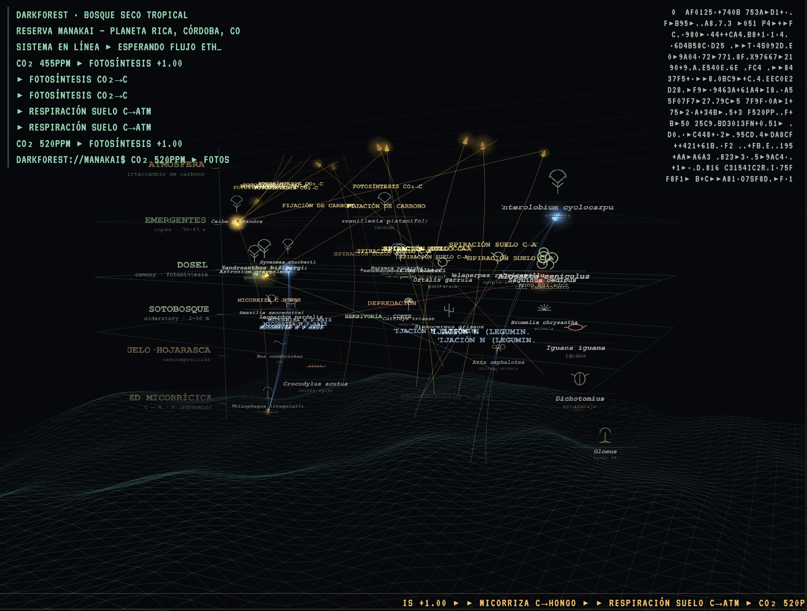

```text
∿─∿─∿─∿─∿─∿─∿─∿─∿─∿─∿─∿─∿─∿─∿─∿─∿─∿─∿─∿─∿─∿─∿─∿─∿─∿─∿─∿─∿─∿─∿

██████╗ ██╗ ██████╗  ██████╗██████╗  █████╗  ██████╗██╗   ██╗
██╔══██╗██║██╔═══██╗██╔════╝██╔══██╗██╔══██╗██╔════╝╚██╗ ██╔╝
██████╔╝██║██║   ██║██║     ██████╔╝███████║██║      ╚████╔╝ 
██╔══██╗██║██║   ██║██║     ██╔══██╗██╔══██║██║       ╚██╔╝  
██████╔╝██║╚██████╔╝╚██████╗██║  ██║██║  ██║╚██████╗   ██║   
╚═════╝ ╚═╝ ╚═════╝  ╚═════╝╚═╝  ╚═╝╚═╝  ╚═╝ ╚═════╝   ╚═╝   
                                                             
             ███████╗███╗   ██╗ ██████╗ ██╗███╗   ██╗███████╗
             ██╔════╝████╗  ██║██╔════╝ ██║████╗  ██║██╔════╝
             █████╗  ██╔██╗ ██║██║  ███╗██║██╔██╗ ██║█████╗  
             ██╔══╝  ██║╚██╗██║██║   ██║██║██║╚██╗██║██╔══╝  
             ███████╗██║ ╚████║╚██████╔╝██║██║ ╚████║███████╗
             ╚══════╝╚═╝  ╚═══╝ ╚═════╝ ╚═╝╚═╝  ╚═══╝╚══════╝
                                                             
        cybernetic feedback → multispecies parliament        
∿─∿─∿─∿─∿─∿─∿─∿─∿─∿─∿─∿─∿─∿─∿─∿─∿─∿─∿─∿─∿─∿─∿─∿─∿─∿─∿─∿─∿─∿─∿
```

[Español](README.md) · **English**

# BiocracyEngine

BiocracyEngine is a live audiovisual instrument. It connects three sources in one feedback loop:

- **The forest:** AudioMoth recordings from a tropical dry forest (Reserva Manakai, Planeta Rica, Córdoba, Colombia).
- **The blockchain:** live Ethereum transactions.
- **The assembly:** a multispecies parliament of species, people and machines.

Each parameter changes the sound (SuperCollider) and the image (browser) at the same time.



## Principles

- **Opacity:** The system does not show some species names. Their sound stays.
- **Absence:** A day with no recording is not empty. It sounds as a weak signal.
- **Phenological time:** The calendar of the forest controls the synthesis.
- **BioToken:** A BioToken records presence and care. You cannot sell it.
- **Parliament:** The same sensors can watch or can give a voice. The structure of power decides which.

## How it works

```
Ethereum ─► eth_sonify.py ─OSC─► SuperCollider ─OSC─► parliament-bridge.js ─WS─► browser
AudioMoth corpus ────────────────►      │
Faderfox LC2 (MIDI) ─────────────►      └─► audio
```

SuperCollider keeps the value of each parameter. The browser, the SC GUI and MIDI send their changes on the same path. All of them get the same echo.

## Start

You must have Node.js, Python 3 and SuperCollider (macOS or Linux).

1. Install the Python packages:
   ```bash
   python3 -m venv eth_listener/venv && source eth_listener/venv/bin/activate && pip install web3 python-osc
   ```
2. Start all the processes:
   ```bash
   ./start_ecosystem.sh
   ```
   For laser projection, use `LASER=1 ./start_ecosystem.sh`.
3. Wait for `=== CONTROL BUS SETUP COMPLETE ===` in `sclang_log.txt`. The engine is then ready.
4. The script opens `http://localhost:9001/parliament.html`. Push a key (0–9, letters) to change the visual module.

## Documentation

| Subject | Document |
|---|---|
| Theory and principles | [Foundations](docs/en/foundations.md) |
| Processes, ports, data flow | [Architecture](docs/en/architecture.md) |
| Visual modules and keys | [Modules](docs/en/modules.md) |
| Parameters, mixer, corpus | [Controls and sound](docs/en/controls.md) |
| Laser projection and safety | [Laser](docs/en/laser.md) |
| Planetarium dome and render | [Dome](docs/en/dome.md) |
| Requirements and monitor | [Diagnostics](docs/en/diagnostics.md) |
| Changes | [CHANGELOG](CHANGELOG.md) |

## License

MIT
