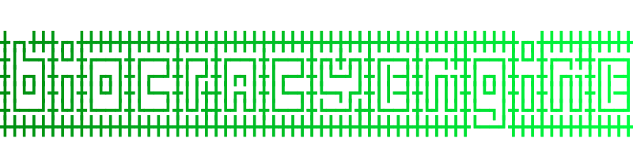

<p align="center">
  
</p>

<p align="center"><em>retroalimentación cibernética → parlamento multiespecie</em></p>

**Español** · [English](README.en.md)

# BiocracyEngine

BiocracyEngine es un instrumento audiovisual en vivo. Une tres fuentes en un solo bucle de retroalimentación:

- **El bosque:** grabaciones AudioMoth de un bosque seco tropical (Reserva Manakai, Planeta Rica, Córdoba, Colombia).
- **La cadena:** transacciones de Ethereum en vivo.
- **La asamblea:** un parlamento multiespecie de especies, personas y máquinas.

Cada parámetro cambia el sonido (SuperCollider) y la imagen (navegador) al mismo tiempo.


## Principios

- **Opacidad:** El sistema no muestra algunos nombres de especies. Su sonido se queda.
- **Ausencia:** Un día sin grabación no está vacío. Suena como una señal débil.
- **Tiempo fenológico:** El calendario del bosque controla la síntesis.
- **BioToken:** Un BioToken registra presencia y cuidado. No se puede vender.
- **Parlamento:** Los mismos sensores pueden vigilar o pueden dar voz. La estructura de poder decide cuál.

## Cómo funciona

```
Ethereum ─► eth_sonify.py ─OSC─► SuperCollider ─OSC─► parliament-bridge.js ─WS─► navegador
Corpus AudioMoth ────────────────►      │
Faderfox LC2 (MIDI) ─────────────►      └─► audio
```

SuperCollider guarda el valor de cada parámetro. El navegador, la GUI de SC y el MIDI envían sus cambios por la misma ruta. Todos reciben el mismo eco.

## Arranque

Necesita Node.js, Python 3 y SuperCollider (macOS o Linux).

1. Instale los paquetes de Python:
   ```bash
   python3 -m venv eth_listener/venv && source eth_listener/venv/bin/activate && pip install web3 python-osc
   ```
2. Arranque todos los procesos:
   ```bash
   ./start_ecosystem.sh
   ```
   Para la proyección láser, use `LASER=1 ./start_ecosystem.sh`.
3. Espere `=== CONTROL BUS SETUP COMPLETE ===` en `sclang_log.txt`. El motor está listo.
4. El script abre `http://localhost:9001/parliament.html`. Pulse una tecla (0–9, letras) para cambiar el módulo visual.

## Documentación

| Tema | Documento |
|---|---|
| Teoría y principios | [Fundamentos](docs/es/fundamentos.md) |
| Cómo escucha: algoritmos y tesis doctoral (Domo del Planetario, 21 oct 2026) | [Escucha](docs/es/escucha.md) |
| Procesos, puertos, flujo de datos | [Arquitectura](docs/es/arquitectura.md) |
| Módulos visuales y teclas | [Módulos](docs/es/modulos.md) |
| Parámetros, mezclador, corpus | [Controles y sonido](docs/es/controles.md) |
| Proyección láser y seguridad | [Láser](docs/es/laser.md) |
| Cúpula de planetario y render | [Cúpula](docs/es/cupula.md) |
| Requisitos y monitor | [Diagnóstico](docs/es/diagnostico.md) |
| Cambios | [CHANGELOG](CHANGELOG.md) |

## Licencia

MIT
