← [README](../../README.md) · solo en español

# Cómo escucha el BiocracyEngine

**Apoyo técnico a la tesis doctoral y a la presentación *Biocracia en escucha*.**

| Tesis doctoral | Presentación |
|---|---|
| ***[de] Bioacústica [a] Biocracia*** — *Parlamento de lo Vivo en el Bosque Seco Tropical* | ***Biocracia en escucha*** — Notaciones y Radiofonías de CK:\WEB, segunda edición |
| **Programa:** Doctorado en Diseño, Arte y Ciencia (D.A.C) | **Fecha:** miércoles 21 de octubre de 2026, 6:00 p. m. |
| **Universidad:** Jorge Tadeo Lozano — Bogotá, Colombia | **Lugar:** Domo del Planetario de Bogotá |
| **Director:** Felipe Cesar Londoño | **Formato:** performance sonoro y audiovisual en el domo; mesa de radio en vivo sobre bioacústica, cibernética y escucha multiespecie |
| **Candidato:** Alejandro Duque Jaramillo | **Entrada:** libre hasta completar aforo |
| **Versión:** junio 15, 2026 (manuscrito en revisión) | |

Este documento explica los algoritmos que usa el BiocracyEngine para escuchar el bosque seco tropical. Explica cada algoritmo en orden: desde la grabadora AudioMoth hasta la decisión de no mostrar. Cada algoritmo tiene un vínculo con un concepto de la tesis doctoral.

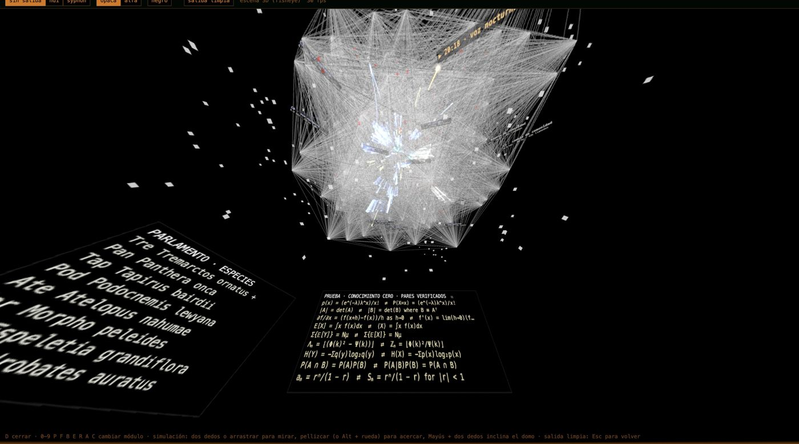

*Módulo 2 en la simulación del domo. La nube de llamados del corpus (etapa 3) cuelga sobre el público. Los nombres de las especies del parlamento aparecen escritos en la cúpula.*

| 261 | 34 / 365 | 8 792 | 16 |
|---|---|---|---|
| grabaciones AudioMoth, a 384 kHz | días del anillo con grabación | llamados que encuentra AVGN, en 28 tipos | grabaciones que nunca se analizan (opacidad) |

## Contenido

- [Cómo leer este documento](#cómo-leer-este-documento)
- [El lugar de este documento en la tesis](#el-lugar-de-este-documento-en-la-tesis)
- [1 · Detectar: los eventos y quién habla](#1--detectar-los-eventos-y-quién-habla)
- [2 · Traducir: el ultrasonido al oído](#2--traducir-el-ultrasonido-al-oído)
- [3 · Encontrar llamados: el espacio latente del corpus](#3--encontrar-llamados-el-espacio-latente-del-corpus)
- [4 · Convocar: la Cámara en el anillo de 365 días](#4--convocar-la-cámara-en-el-anillo-de-365-días)
- [5 · Responder: antifonía y nicho acústico](#5--responder-antifonía-y-nicho-acústico)
- [6 · Mezclar: la neurona y el libro mayor](#6--mezclar-la-neurona-y-el-libro-mayor)
- [7 · La cadena actúa sobre el bosque](#7--la-cadena-actúa-sobre-el-bosque)
- [8 · Retener: la opacidad como arquitectura](#8--retener-la-opacidad-como-arquitectura)
- [En el domo del Planetario](#en-el-domo-del-planetario)
- [Lo que estos algoritmos no pueden afirmar](#lo-que-estos-algoritmos-no-pueden-afirmar)
- [Glosario](#glosario)

## Cómo leer este documento

El texto usa un español técnico simplificado, según las reglas de ASD-STE100. Las frases son cortas. Cada frase da una sola información. Un término tiene siempre el mismo significado; el [glosario](#glosario) al final da la definición.

Cada algoritmo tiene una ficha con cuatro partes:

1. **Qué hace.** La operación, en dos o tres frases.
2. **Fórmula.** La regla matemática, con los valores reales del código.
3. **Dónde.** El archivo del repositorio que la ejecuta.
4. **Tesis.** El concepto o el artículo de la tesis que el algoritmo hace operar.

Una etiqueta indica a qué mundo pertenece cada algoritmo:

- 🟠 **Bosque** — la escucha del territorio
- 🔵 **Cadena** — Ethereum
- 🟣 **Mezcla** — bosque y cadena juntos
- ⚪ **Velo** — lo que se retiene

Las imágenes son capturas de los módulos del BiocracyEngine, hechas el 17 de octubre de 2026 sin SuperCollider en marcha (en vivo hay más actividad). Algunas muestran la simulación del domo.

## El lugar de este documento en la tesis

La tesis propone la **biocracia**: un sistema de gobernanza en el que las decisiones sobre el territorio se toman *con* las formas de vida que lo comparten. La biocracia tiene tres pilares: la escucha técnica-artística, la gobernanza comunitaria extendida y la infraestructura tecnológica distribuida.

Este documento explica el primer pilar en detalle técnico. También muestra cómo el código conecta con el estatuto de la Cámara Fenológica de lo Vivo (Anexo B, Artículos 41 a 48).

El Capítulo 4 de la tesis define el BiocracyEngine como un **Objeto de Investigación Liminal**: un objeto que no ilustra la teoría, sino que la hace operar. Este documento es la documentación técnica de ese objeto.

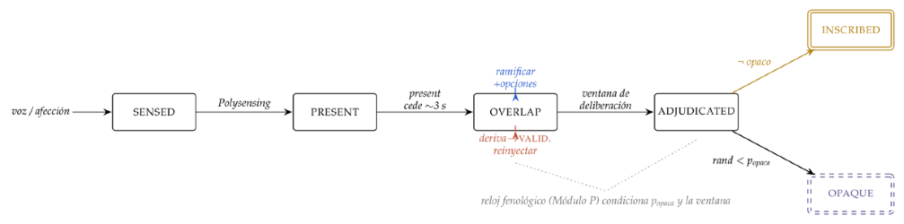

*Tesis, Anexo A, Figura 3. El autómata. Una voz pasa por cuatro estados: SENSED, PRESENT, OVERLAP y ADJUDICATED. Después tiene dos salidas: INSCRIBED u OPAQUE. OPAQUE es un estado de aceptación, no un fallo. Las ocho etapas de este documento siguen este recorrido.*

---

## 1 · Detectar: los eventos y quién habla

`bioacustic-scripts / bioacoustic_detector` · se ejecuta una vez sobre la carpeta del AudioMoth
**Tesis:** Cap. 1 §3 (AudioMoth e índices ecoacústicos), §4.1 (escucha ausente) · Cap. 4 §2 (el oído del Parlamento)

El AudioMoth graba archivos de 60 segundos a 384 kHz. Un detector encuentra los momentos en que algo ocurre. Después da a cada evento un rol ecológico. El detector no da nombres de especies. El corpus tiene roles, no taxones.

> **Vínculo con la tesis.** La tesis llama a esta condición **escucha ausente** (Berenguer y Gómez, 2020). Nadie escucha en el momento de la grabación. Pero el oído está en el diseño: en la frecuencia de muestreo, en el horario de grabación y en los algoritmos que deciden qué partes merecen atención. Esta etapa es ese oído diferido.

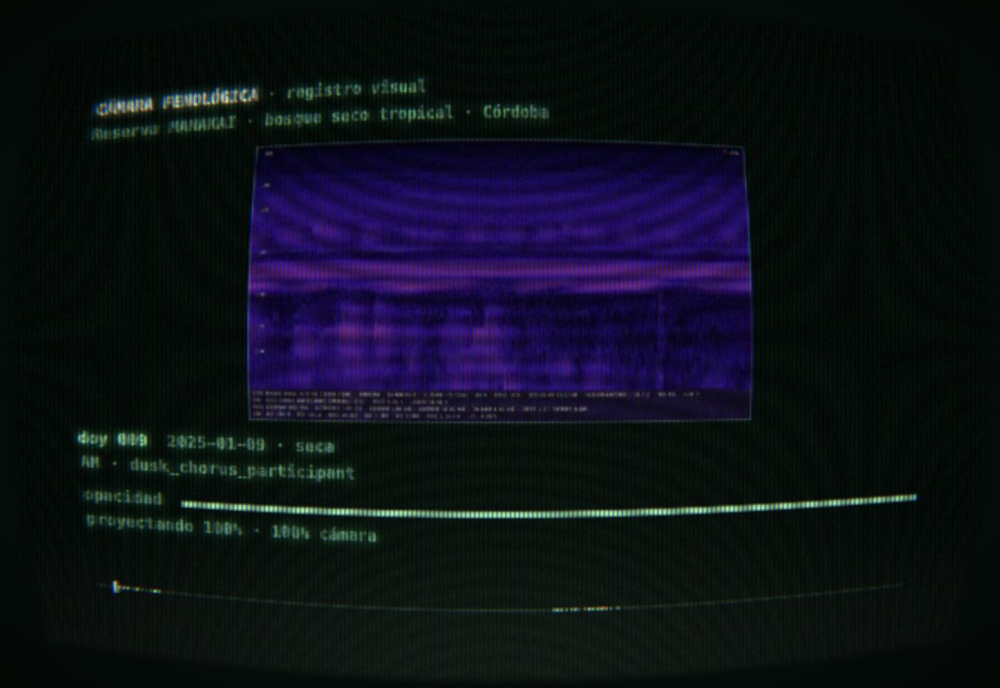

*Módulo C · Cámara. El espectrograma de una grabación del corpus, con su día del año (009), su temporada (seca) y su rol (dusk_chorus_participant). Es el mismo dato que produce el detector, mostrado en lugar de oído.*

### Transformada de Fourier y flujo espectral · 🟠 Bosque

La transformada de Fourier de tiempo corto (STFT) da el espectro de cada fragmento de la grabación. El flujo espectral mide cuánto sube el espectro de un fragmento al siguiente. Un comienzo de sonido aparece como un pico de flujo.

```
flujo[n] = √ Σₖ max(0, |X[n,k]| − |X[n−1,k]|)²
```

Dónde: `spectral.py` · `stft`, `spectral_flux`

### Umbral adaptativo (mediana móvil y MAD) · 🟠 Bosque

El umbral sigue la línea de base de cada grabación. Usa la mediana móvil y la desviación absoluta mediana (MAD). Así, una noche ruidosa no oculta sus eventos y una noche silenciosa no inventa eventos. El detector une los eventos cercanos y descarta los eventos muy cortos.

```
evento ⇔ flujo > mediana + 2,5 · 1,4826 · MAD   (ventana ≤ mitad del archivo)
```

Dónde: `detector.py` · `running_median_mad`, `detect_events`

### Índices ecoacústicos · 🟠 Bosque

Los índices miden cómo se organiza el paisaje sonoro completo, sin identificar cada vocalización. Alimentan la serie fenológica y los valores de actividad de cada grabación: ACI (complejidad acústica), BI (índice bioacústico), NDSI (biofonía contra antropofonía), ADI (diversidad acústica) y AEI (equidad acústica).

Dónde: `indices.py`
**Tesis**, Cap. 1 §3.2: cada índice es una hipótesis sobre qué diferencia importa. La elección de los índices es una decisión política, deliberada con la comunidad desde 2024.

### Energía por bandas, cresta, entropía, centroide, planitud · 🟠 Bosque

El detector divide la energía de cada evento en bandas ecológicas. Agrega tres bandas ultrasónicas: 16–40 kHz (murciélagos molósidos, saltamontes), 40–80 kHz (la mayoría de los murciélagos en búsqueda) y 80–160 kHz (filostómidos de frecuencia alta). La cresta y la entropía separan un canto tonal de un ruido. La planitud separa un tono de la lluvia.

Dónde: `spectral.py` · `band_energies`, `band_crest`, `band_entropy`, `spectral_flatness` · `config.py`

### Periodicidad de la envolvente · 🟠 Bosque

Esta medida separa un coro del clima. Los llamados se repiten a un ritmo propio de cada especie. Entonces, la envolvente de una banda con cantos es un tren de pulsos. La lluvia y el viento no son periódicos. La medida toma el primer pico local de la autocorrelación de la envolvente, entre 0,5 y 20 Hz.

```
periodicidad, ritmo = primer pico local de acf(envolvente sin tendencia), retardos de 1/20 a 1/0,5 s
```

Dónde: `spectral.py` · `envelope_periodicity`

### Clasificador por reglas: los roles ecológicos · 🟠 Bosque

Unas reglas calibradas a mano dan a cada evento uno de 16 roles, en cuatro dominios: biofonía, geofonía, antropofonía y transición. Las reglas usan la hora, la banda dominante, la planitud, el centroide, la duración y el salto de flujo. Cada rol tiene una confianza. Una segunda pasada nombra todas las bandas con energía suficiente: un estanque de noche tiene ranas abajo, insectos arriba y murciélagos más arriba, al mismo tiempo.

Roles, por ejemplo: `nocturnal_voice`, `insect_chorus`, `dusk_chorus_participant`, `dawn_chorus_participant`, `community_shift`, `silence_to_activity`, `bat_echolocation`, `rain_event`, `aircraft_passage`.

Dónde: `classifier.py` · `classify_event`, `classify_soundscape`
**Tesis**, Cap. 1 §2.3: la tesis usa la tripartición de Pijanowski (biofonía, geofonía, antropofonía) como vocabulario operativo, pero rechaza su lectura ontológica.

### Detección de eventos fenológicos · 🟠 Bosque

Unas reglas comparan los resúmenes de días sucesivos. Buscan cambios de temporada, no de segundos: el inicio del coro reproductivo, un cambio migratorio (ADI), la transición a la temporada de lluvias y el adelanto o retraso del coro del amanecer.

Dónde: `phenology.py` · `_detect_phenological_events`

---

## 2 · Traducir: el ultrasonido al oído

`tools/build_corpus.py` · los originales se abren solo para lectura
**Tesis:** Anexo B, Art. 42 (calendario rector) · Art. 44 (la voz como ausencia)

De noche, la mayor parte del bosque suena por encima de 20 kHz. El oído humano no llega a esa banda. El constructor del corpus prepara cuatro capas que SuperCollider puede reproducir. Después coloca cada grabación en el anillo de 365 días.

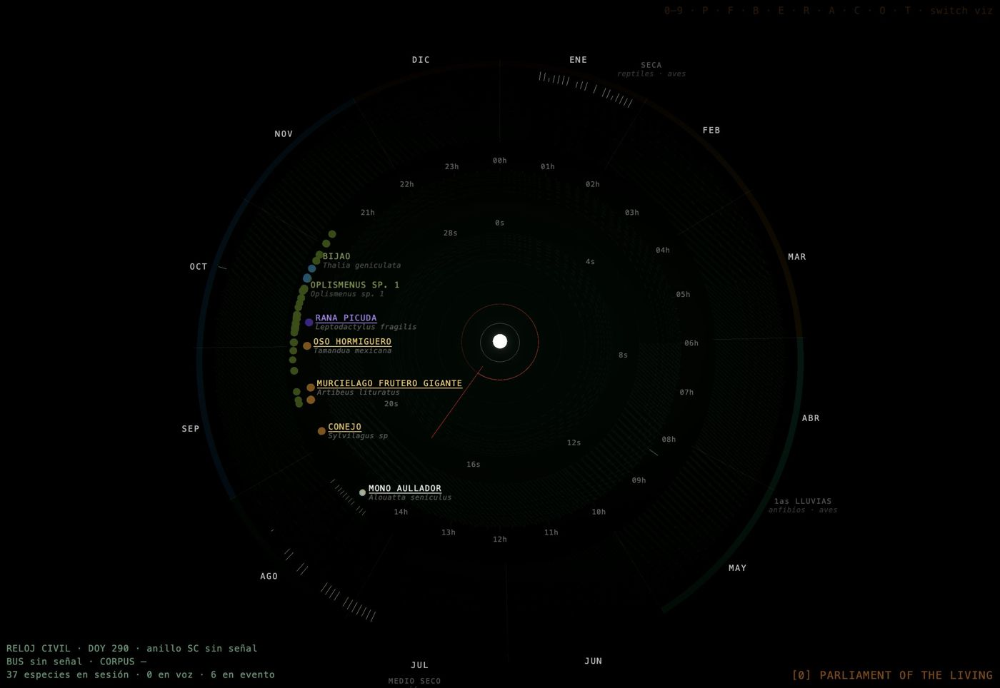

*Módulo 0 · el Hemiciclo. El anillo del año, con los meses alrededor. Cada especie ocupa su lugar en el día de su pico de actividad. El cursor avanza por el anillo y convoca a quien está en su ventana.*

### Diezmado sin aliasing, de 384 a 48 kHz · 🟠 Bosque

Esta es la capa audible. El material tiene mucha energía real por encima de 24 kHz. Un filtro débil la devolvería al rango audible como insectos falsos. El filtro rechaza 130 dB, medido con un tono de 60 kHz.

Parámetros: `aresample filter_size 256`, corte 0,97, techo −3 dBFS.

### Expansión temporal ×8 · 🟠 Bosque

Un filtro pasa-altos a 38 kHz quita lo audible. Después, las muestras de 384 kHz se leen como si fueran de 48 kHz. Cada 20 s de grabación duran 160 s. La ecolocalización de los murciélagos baja a 4,75–24 kHz. Solo llega lo que era realmente inaudible. Esta capa no está sincronizada con la capa audible: el tiempo del murciélago no es el nuestro.

```
f_oída = f_grabada / 8      t_oído = t_grabado × 8
```

Parámetros: proporción ultrasónica ≥ 0,20; +12 dB; 69 grabaciones.

### Heterodinación · 🟠 Bosque

Para las capas por fuente, la banda ultrasónica se heterodina en lugar de expandirse. Así conserva el tiempo real y se puede mezclar con las otras capas.

### Granos de inicio · 🟠 Bosque

Son cortes breves en el comienzo de los eventos de mayor confianza de cada día. Son pequeños y quedan en memoria. Son el material de los llamados de Antifonía y de la percusión GOLPE.

### Lugar en el anillo y profundidad de la ausencia · 🟠 Bosque

Cada grabación va a su día del año, con su temporada. Para cada una de las 365 posiciones, el constructor calcula la distancia al día grabado más cercano. Así la ausencia tiene forma. 331 de los 365 días no tienen grabación.

**Tesis**, Art. 42: la Cámara no sesiona por el calendario gregoriano; su tiempo rector es un anillo de 365 días. Art. 44: la ausencia no es abstención; es una frase del territorio.

---

## 3 · Encontrar llamados: el espacio latente del corpus

`tools/build_avgn.py` → `corpus/avgn.json` · módulos 2 y O
**Tesis:** Cap. 1 §5.2 y Cap. 4 §2.1 (hipótesis distribucional acústica) · Cap. 3 §2 (vectorización constitucional)

Esta etapa sigue el método AVGN de Sainburg, Thielk y Gentner (2020). Ese método mapea repertorios vocales de animales. El detector dice cuándo ocurrió algo. AVGN encuentra cada llamado y los agrupa por su forma, sin etiquetas previas.

> **Vínculo con la tesis.** Esta etapa es la forma concreta de la **hipótesis distribucional acústica**: las vocalizaciones que ocurren en contextos ecológicos similares tienen significados ecológicos similares (Gastaldi, 2021; Harris, 1954). Cada llamado se vuelve un punto en un espacio geométrico. La distancia entre puntos mide su parecido. La tesis señala también una consecuencia: el espacio guarda la presencia y la forma del llamado, no la identidad del individuo. Es la opacidad por diseño.

<p>
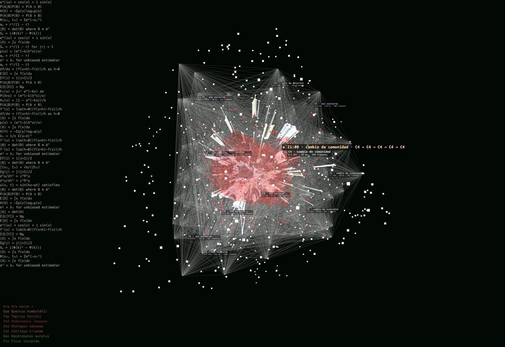
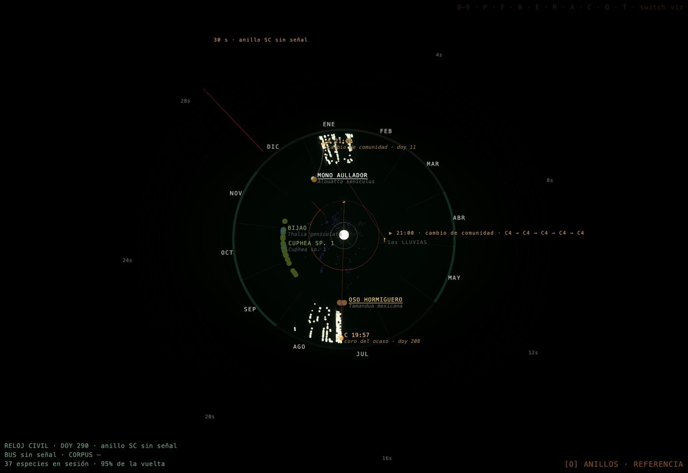
</p>

*Izquierda: módulo 2, el mapa AVGN en 3-D. Cada punto es un llamado. Los hilos unen los llamados de una misma grabación. Derecha: módulo O, el mapa AVGN en 2-D, como un disco sobre el anillo del año. Hilos ámbar bajan del llamado que suena hasta su día en el anillo.*

### Quitar el piso de cada banda · 🟠 Bosque

Antes de segmentar, el algoritmo resta la mediana de cada banda de frecuencia. Es necesario porque el coro nocturno nunca para. Sin este paso, el 87 % de las unidades eran fragmentos de coro de 0,6 s.

### Umbral dinámico · 🟠 Bosque

El umbral sube de 6 a 30 dB sobre el piso, en pasos de 3 dB. Para cuando las unidades son suficientemente cortas para ser llamados. Las unidades de más de 0,6 s se encadenan. Cada grabación conserva sus 40 unidades más fuertes.

Parámetros: `LEVEL_DB 6 → 30`, `MAX_UNIT_S 0,6`, 40 unidades por grabación.

### Teselas log-mel · 🟠 Bosque

Cada llamado se vuelve un espectrograma log-mel de 32 × 24, del mismo tamaño para todos. Los llamados duran entre 45 y 165 ms.

### UMAP en 3-D y 2-D · 🟠 Bosque

UMAP (Uniform Manifold Approximation and Projection) coloca cerca los llamados parecidos. El módulo 2 muestra la nube en 3-D. El módulo O muestra el disco en 2-D.

Parámetros: `n_neighbors 15`, `min_dist 0,25`, semilla 7. Referencia: McInnes, Healy y Melville, 2018.

### Agrupamiento HDBSCAN · 🟠 Bosque

Un agrupamiento por densidad da 28 tipos de llamado. Los llamados que no pertenecen a ningún grupo quedan sin grupo. El algoritmo no los fuerza.

Parámetros: `min_cluster_size máx(10, n/100)`, `min_samples 5`.

### Recorrido en vivo · 🟠 Bosque

Cuando una grabación suena, sus llamados se encienden en orden sobre el mapa, con el reloj de la propia grabación. Una estela corta muestra el camino. Así se ve en qué parte del repertorio habla el bosque en este momento.

Dónde: `nw_wrld_local/src/projector/avgn/avgnMap.ts`

---

## 4 · Convocar: la Cámara en el anillo de 365 días

`14_phenological_corpus.scd` (SuperCollider) · módulo P (calendario fenológico)
**Tesis:** Anexo B, Arts. 42, 43, 44 y 45 · Anexo A (tabla de correspondencias código ↔ estatuto)

El anillo gira. Por defecto avanza un día fenológico por minuto. Cada día, la Cámara responde tres preguntas: quién está presente, quién tiene el escaño encendido y qué suena en el silencio. Cada regla corresponde a un artículo del estatuto.

<p>
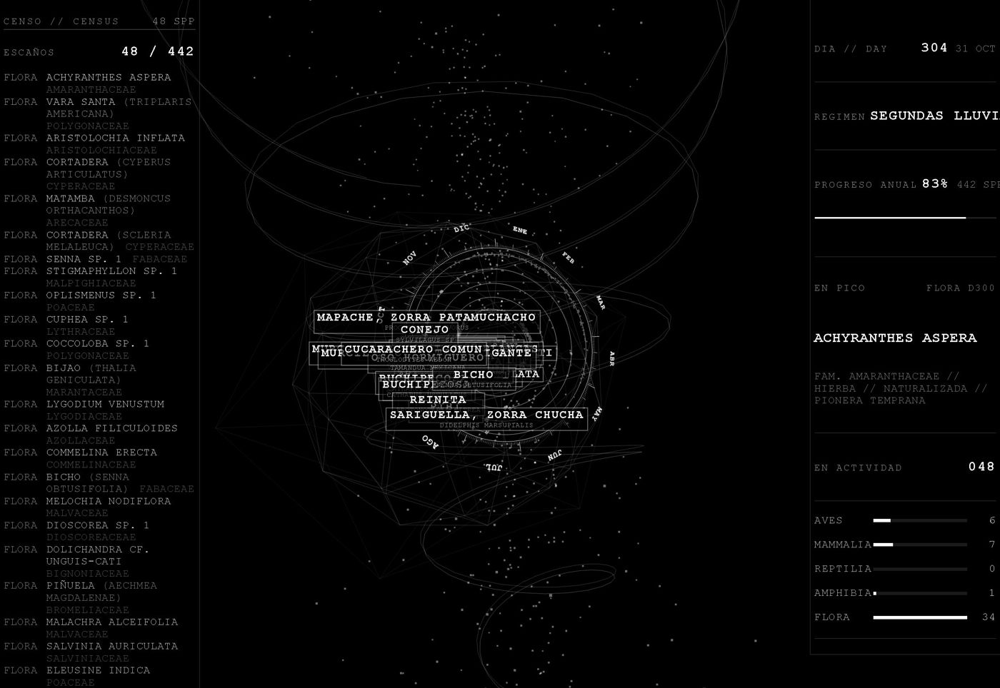
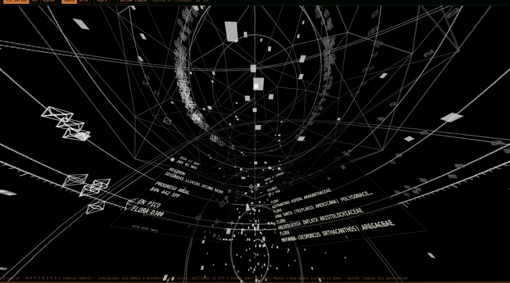
</p>

*Izquierda: módulo P · Calendario fenológico. El dial del año, el censo de especies a la izquierda y la temporada a la derecha (segundas lluvias). Es el módulo P que nombran los Artículos 42 y 45. Derecha: el módulo P en el domo. El dial es el cielo. El año corre alrededor del borde. El día y el censo se leen en dos tarjetas a los lados del frente.*

> **Dos tipos de bancada.** El estatuto (Art. 43) define cinco bancadas taxonómicas sobre el inventario de la Reserva: FLORA, AVES, AMPHIBIA, REPTILIA y MAMMALIA. El módulo P las usa. Pero el corpus de audio no tiene taxonomía: el detector solo da roles. Por eso la capa sonora agrupa las grabaciones por rol: TODAS, NOCTURNA, INSECTOS, CORO y TRANSICIÓN. Las dos clasificaciones conviven. El código documenta esta diferencia en lugar de esconderla.

### Presencia: una ventana gaussiana en el anillo · 🟠 Bosque

Una grabación se oye desde los días cercanos del anillo. Su presencia baja con la distancia. La ventana nunca inventa audio para un día sin grabación. Solo deja que una grabación real llegue más lejos. La confianza del detector y la actividad del día la modulan. El sesgo estacional la inclina hacia la seca o hacia las lluvias.

```
presencia = e^(−d² / 2σ²) · (0,45 + 0,35·confianza + 0,20·actividad) · (1 ∓ 0,45·sesgo)
σ = 3 · VENTANA días      alcance = 6 · VENTANA días
```

**Tesis**, Art. 43: cada especie tiene una ventana de actividad gaussiana alrededor de su día pico. El escaño se enciende y se apaga cuando el cursor entra y sale de la ventana.

### Umbral y quórum sensible · 🟠 Bosque

Por encima del umbral, el escaño se enciende y suena. Por debajo, la especie está presente en el territorio pero silente en la Cámara. El quórum sensible es la fracción de los escaños convocados que están encendidos.

```
quórum = |{presencia ≥ UMBRAL}| / |convocados|      (0 en un día sin grabación)
UMBRAL por defecto = 0,5
```

**Tesis**, Art. 44: el umbral de actividad es 0,5. Art. 45: quórum alto ≥ 60 %, medio entre 30 % y 60 %, bajo < 30 %. Art. 48: cambiar el umbral de 0,5 requiere el 80 % de los votos.

### Primer plano: los llamados sobre el coro · 🟠 Bosque · NUEVO

La mediana de la energía audible del corpus es 94 % coro estable de insectos, entre 4 y 24 kHz. Once bandas de media octava siguen cada una su propio piso. El piso baja rápido y sube lento. Una banda a 4 dB o menos de su piso baja hasta 15 dB. Una banda a 10 dB sobre su piso queda abierta. Las bandas por debajo de 1,4 kHz bajan mucho menos: ahí cantan ranas, aves y mamíferos. La bancada fija la cantidad: 0 en INSECTOS, 1 en NOCTURNA y CORO.

```
abierta = recortar((L − piso − 4 dB) / 6 dB, 0, 1)      corte = (1 − abierta) · cantidad · (−4,5 … −15 dB)
```

Dónde: `14_phenological_corpus.scd` · `~phenoForeground`

### La voz de la ausencia · 🟠 Bosque · NUEVO

En un día sin grabación, las grabaciones reales más cercanas pueden sonar solo como ultrasonido expandido. Cuanto más profunda es la ausencia, menos probable es. La selección sale de la bancada activa y prefiere las grabaciones cercanas al día. Cada bancada pesa según la raíz cuadrada de su tamaño. La parte de INSECTOS bajó del 74 % al 39 %.

```
P(grabación) ∝ e^(−d² / 2·45²) / √n_bancada      probabilidad = AUSENCIA · (1 − mín(hueco/120, 0,85))
```

**Tesis**, Art. 44: la voz es presencia y también ausencia. Lo que llena el silencio es justamente lo que el oído humano no alcanza.

### El aliento inverso · 🟣 Mezcla

El bosque toca el sintetizador. El quórum, multiplicado por PULSO, sube la riqueza armónica y la profundidad de la textura del motor. También sale a todos los módulos visuales como `/bio/consensus`. La absorción de la sala es también el quórum: una Cámara vacía resuena más que una llena.

**Tesis**, Art. 45: «El bosque toca el sintetizador, y la mano que afina es la temporada.» Los buses harmonicrich y texturedepth del estatuto son estos.

---

## 5 · Responder: antifonía y nicho acústico

`Antifonia.js` (módulo A) · `16_corpus_calls.scd` · `19_golpe.scd` · módulo F
**Tesis:** Cap. 1 §2.3 (nicho acústico de Krause) · Cap. 2 §6 (agenciamientos multiespecie)

La antifonía es el canto alternado: un dueto, una pareja que responde, una bandada. También es la forma más antigua del parlamento: hablar por turnos.

<p>
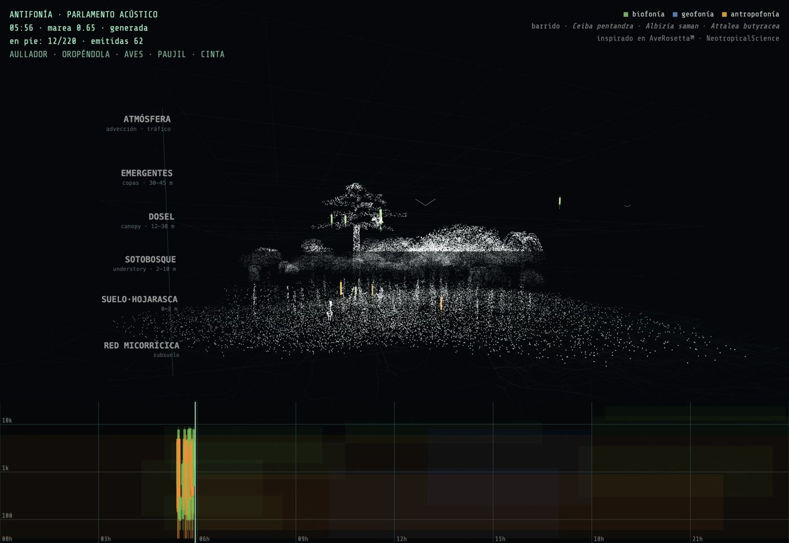
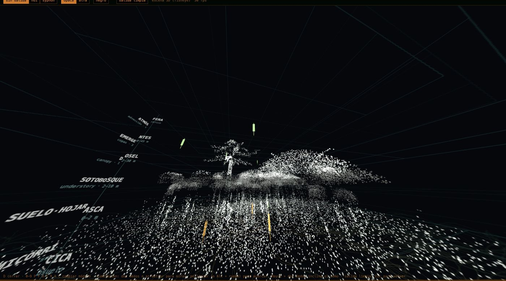
</p>

*Izquierda: módulo A · Antifonía. Un rodal simulado con LiDAR: una ceiba emergente, campanos y palmas. Cada llamado enciende la altura desde la que se emite. Abajo, la franja del nicho: tiempo y frecuencia de cada llamado. Derecha: el módulo A en el domo. El rodal rodea al público. Los nombres de los estratos se leen en la cúpula.*

### Reparto del nicho acústico · 🟠 Bosque

Cada fuente tiene su banda de frecuencia, su estrato y su ventana circadiana. Por ejemplo: el mono aullador, 120–1 800 Hz, desde las emergentes, de 04:18 a 08:00; las ranas, 300–3 500 Hz, desde el sotobosque, de 17:36 a 23:30; los murciélagos, 12–60 kHz, en el dosel. La franja del nicho muestra la hipótesis: las especies reparten banda y hora para no enmascararse.

**Tesis**, Cap. 1 §2.3: Krause introduce el nicho acústico; la biofonía es una arquitectura distribuida, no una suma de emisores aislados.

### Compuerta de turnos · 🟣 Mezcla

Cuando sube el acuerdo de la Cámara, cada voz canta solo en su fase de un turno compartido. El acuerdo suena como alternancia, no como unísono.

```
turno = 0,5 + 0,5·sen(2π · 0,35 · fase)      compuerta = 1 − 0,85·sinc + 0,85·sinc·turno²
```

### Un llamado respondido por una grabación · 🟠 Bosque

Un llamado dice quién habla y cuándo. SuperCollider busca los roles del corpus que pueden responder por esa especie. Después toca un grano de una grabación real. El avión y la cinta conservan sus MP3: el corpus no tiene antropofonía para ofrecer.

Dónde: `16_corpus_calls.scd`

### Granos del bosque en la percusión · 🟠 Bosque

GOLPE golpea con granos de 20 a 120 ms de grabaciones AudioMoth, del rol que convoca la bancada. Nunca usa grabaciones opacas. La bancada también da color al golpe. CORO responde con la tabla.

Dónde: `19_golpe.scd`

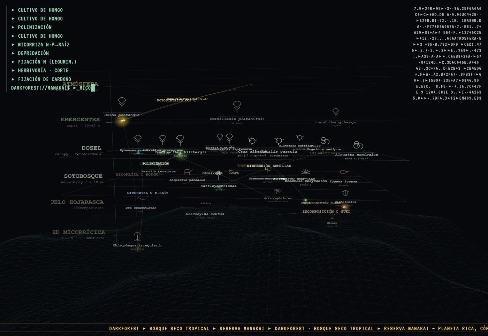

*Módulo F · DarkForest. Los estratos de Humboldt, de la red micorrícica a las emergentes. Quien canta, canta desde una altura. La terminal registra lo que el bosque intercambia: polinización, dispersión de semillas, fijación de carbono.*

---

## 6 · Mezclar: la neurona y el libro mayor

`blend/blendLayer.ts` · `manim/formulas.json` · `sources.ts` · módulos 4–9 y B
**Tesis:** Anexo A (Figuras 1–3, Benevolence Engine) · Cap. 3 §6 (medios neuronales) · Cap. 4 §6

Los dos espacios de entrada del motor se encuentran: el bosque, leído como un sistema nervioso, y Ethereum, leído como un libro mayor. El método es la mezcla conceptual de Fauconnier y Turner. Cada módulo de 4 a 9 ejecuta una ley de cada lado con datos vivos. El número junto a cada fórmula es su resultado en ese momento. En orden, los seis módulos cuentan el autómata de la tesis: de SENSED a OPAQUE.

> **Vínculo con la tesis.** El nombre del motor viene del **Benevolence Engine** de Bill Seaman y Otto Rössler (2006). Su regla ética viene de Heinz von Foerster: «A está mejor si B está mejor». El buffer de solapamiento (OVERLAP) separa la detección de la adjudicación: simula antes de ejecutar. Esa demora es el parlamento.

<p>
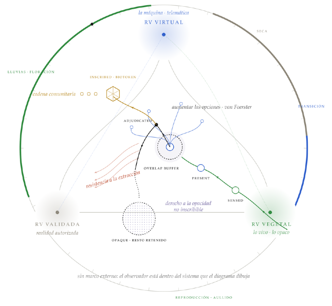
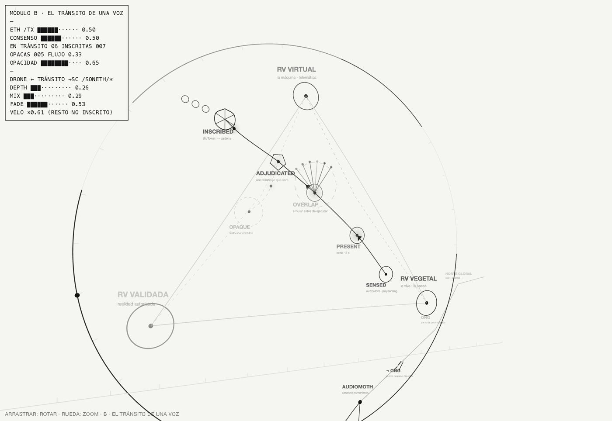
</p>

*Izquierda: tesis, Anexo A, Figura 1. El tránsito de una voz. La voz entra por lo Vegetal, se siente en el AudioMoth, se hace presente, se retiene, se adjudica y se bifurca. El anillo es el reloj fenológico. Derecha: módulo B · Tránsito. La Figura 1 de la tesis, ejecutada en vivo. Una voz recorre los estados. El panel superior muestra la profundidad, la mezcla y el velo de opacidad en cada momento.*

### Separación de fuentes con máscara de Wiener · 🟣 Mezcla

El espectro maestro se divide en cuatro fuentes: BOSQUE, MÁQUINA, LECHO y AIRE. El método toma de HTDemucs la representación y la máscara suave, no la red neuronal. Cada fuente conserva la parte de cada banda que su potencia reclama. De aquí sale λ: la parte de la cadena en lo que se oye ahora.

```
Mₛ(f) = Pₛ(f) / Σᵢ Pᵢ(f)      λ = máquina / (bosque + máquina)
```

Dónde: `sources.ts`

| | | |
|---|---|---|
| 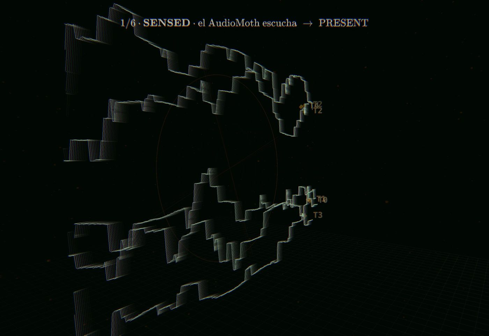 **4 · SENSED** · DRONE | 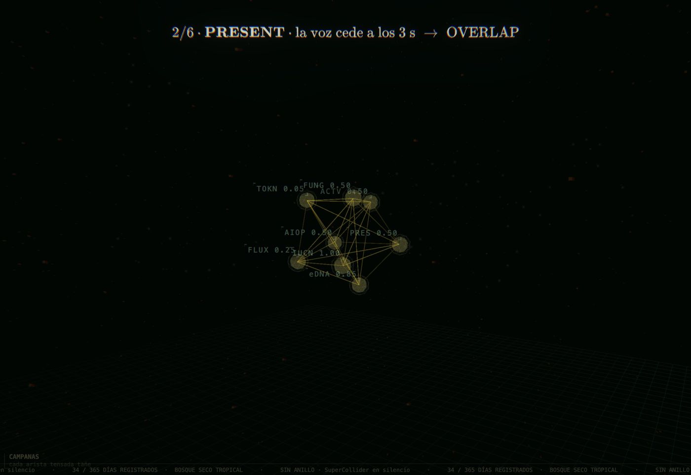 **5 · PRESENT** · CAMPANAS | 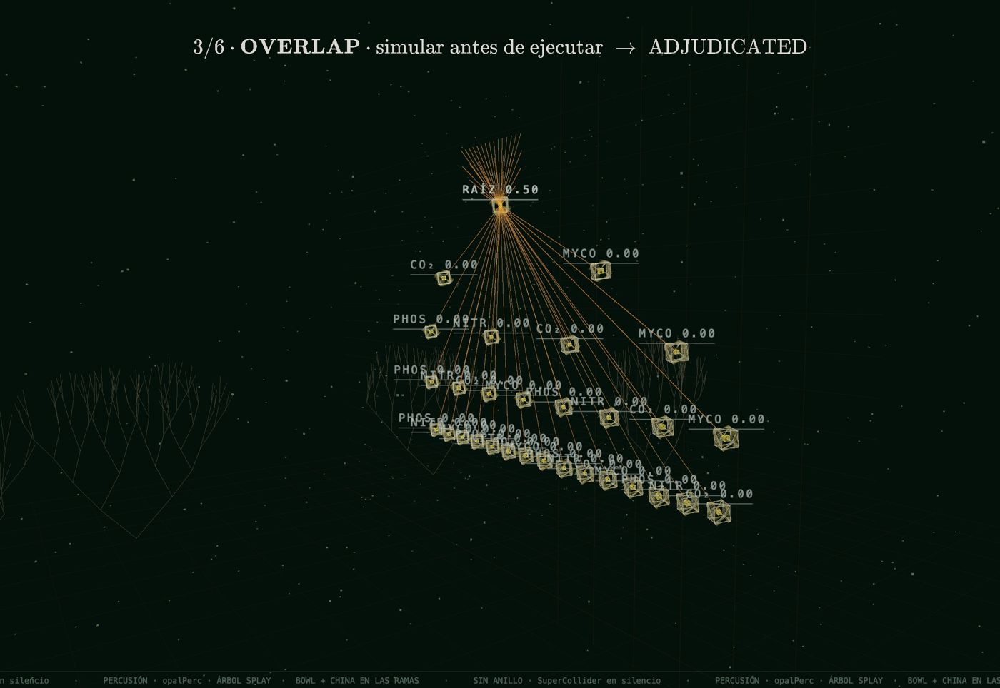 **6 · OVERLAP** · PERCUSIÓN |
| 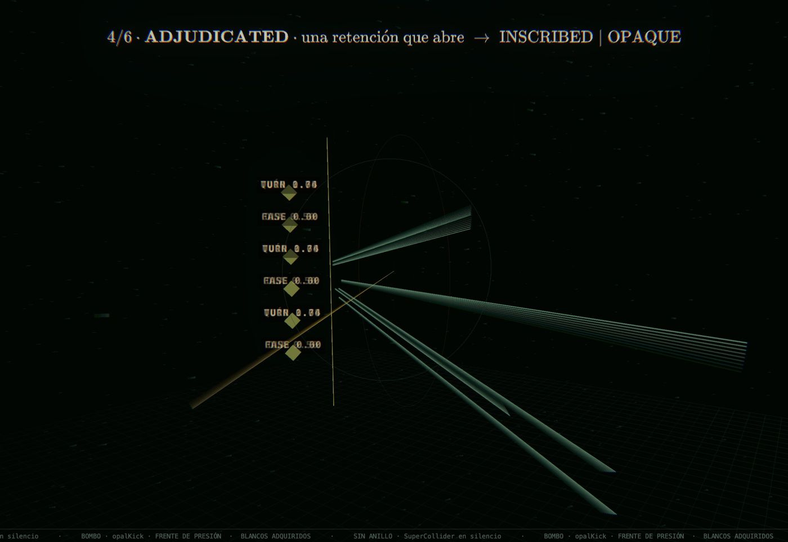 **7 · ADJUDICATED** · BOMBO | 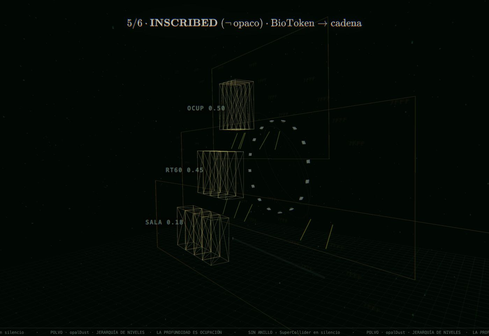 **8 · INSCRIBED** · POLVO | 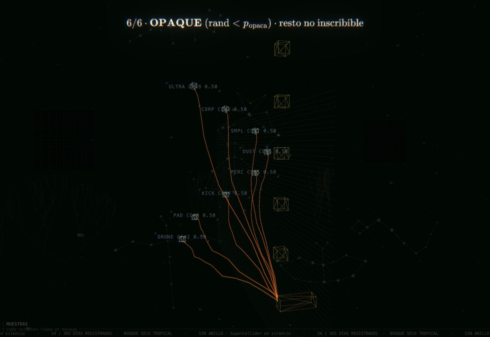 **9 · OPAQUE** · MUESTRAS |

### 4 · SENSED: integrar y disparar con fuga · el gas que sella · 🟣 Mezcla

Una membrana suma el canto del bosque y dispara al llegar a θ. Un bloque se llena de gas y se sella. La diferencia es la fuga: la membrana olvida, el bloque no.

```
τ dV/dt = −V + R·I(t),  V ≥ θ ⇒ disparo      G(n+1) = G(n) + g_tx,  G ≥ G_máx ⇒ sello
```

### 5 · PRESENT: Hebb sobre la copresencia · el valor que se mueve · 🟣 Mezcla

El peso entre seis subbandas del bosque crece cuando suenan juntas y se olvida en 3 s: la red micorrícica como grafo de Hebb. En la cadena, el peso entre dos direcciones es el valor que se mueve entre ellas.

```
Δw_ij = η·x_i·x_j      Δw_ab = v(a→b)      BioToken = pres · act · eDNA · hongos · IA · IUCN
```

**Tesis**, Anexo A: el buffer de presente del Benevolence Engine se desvanece en unos 3 s.

### 6 · OVERLAP: potenciación dendrítica · árbol splay · 🟣 Mezcla

Una dendrita se fortalece donde el bosque y la máquina suenan juntos, y se debilita con γ. Las cuatro fuentes están en una lista que se ajusta sola (mover al frente, la forma de lista de un árbol splay). Lo que más se usa sube a la raíz.

```
Δw = η·r_pre·r_post − γ·w      ĉ(x) ≤ 3·(r(raíz) − r(x)) + 1
```

### 7 · ADJUDICATED: campo receptivo · Voronoi · 🟣 Mezcla

Un campo receptivo gaussiano barre el círculo de bandas, afinado al centroide del bosque. Las celdas de Voronoi adjudican cada banda a la fuente más cercana, como una máscara dura.

```
r(θ) = r_máx · e^(−(θ−θ₀)² / 2σ²)      V_i = {x : ‖x − p_i‖ ≤ ‖x − p_j‖ ∀j}
```

### 8 · INSCRIBED: curva del olvido · jerarquía de caché · 🟣 Mezcla

El bosque olvida; el libro mayor no. El espectrograma se guarda en tres niveles: L1 (los últimos 0,4 s), L2 (hasta 2 s) y L3 (hasta 6 s). El módulo calcula en vivo el tiempo medio para encontrar el último canto.

```
R(t) = e^(−t/S)      AMAT = t_acierto + m · t_fallo
```

### 9 · OPAQUE: el hash de la mosca · keccak256 · 🟣 Mezcla

El circuito olfativo de la mosca de la fruta es un hash sensible a la localidad. Aquí, 256 células de Kenyon suman cada una 6 bandas al azar de las 96 del bosque. Las 12 más activas ganan. Sonidos parecidos dan huellas parecidas. Al lado está el keccak256 del bloque: un bit distinto cambia la mitad de la huella. Una parte de las dos huellas nunca se muestra; la cláusula de opacidad fija esa parte.

```
h(x) = WTA₁₂(M·x),  M ∈ {0,1}^(256×96) dispersa      h(x) = keccak256(x)
```

Referencia: Dasgupta, Stevens y Navlakha, 2017.

### Bancos de resonadores modales · 🟣 Mezcla

Un cuerpo golpeado no se ilumina: resuena. Cada módulo se mueve con un banco de modos amortiguados (de 10 a 40 modos, amortiguación de 0,86 a 0,995). Así un bombo y una campana hacen gestos distintos.

Dónde: `resonators.ts`

---

## 7 · La cadena actúa sobre el bosque

`eth_sonify.py` · `6_osc_handlers.scd` · `17_chain_processing.scd` · módulos E y R
**Tesis:** Cap. 4 §6 (la sonificación especulativa) · Cap. 3 §3.3 (crítica al Proof of Work)

El motor consulta Ethereum mainnet cada pocos segundos. La cadena no toca notas sobre el bosque. La cadena fija las condiciones en las que se oyen las grabaciones.

> **Vínculo con la tesis.** La tesis separa dos registros. El primero es **documental**: el motor hace sonar Ethereum mainnet como diagnóstico de una infraestructura financiera planetaria. El segundo es **constitucional**: la cadena del dIAP del Parlamento de lo Vivo es una decisión pendiente con la comunidad de El Balzal (Algorand, Hedera o una capa 2 de Ethereum). Esta etapa es solo el registro documental. «Una red que se escucha es una red que no puede esconderse.»

<p>
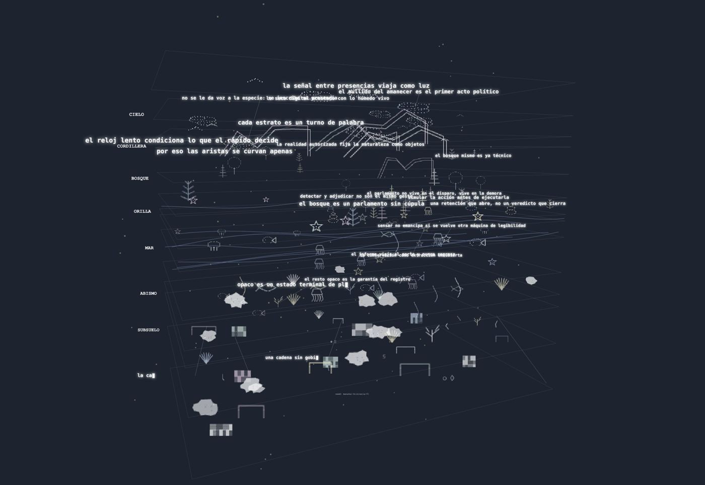
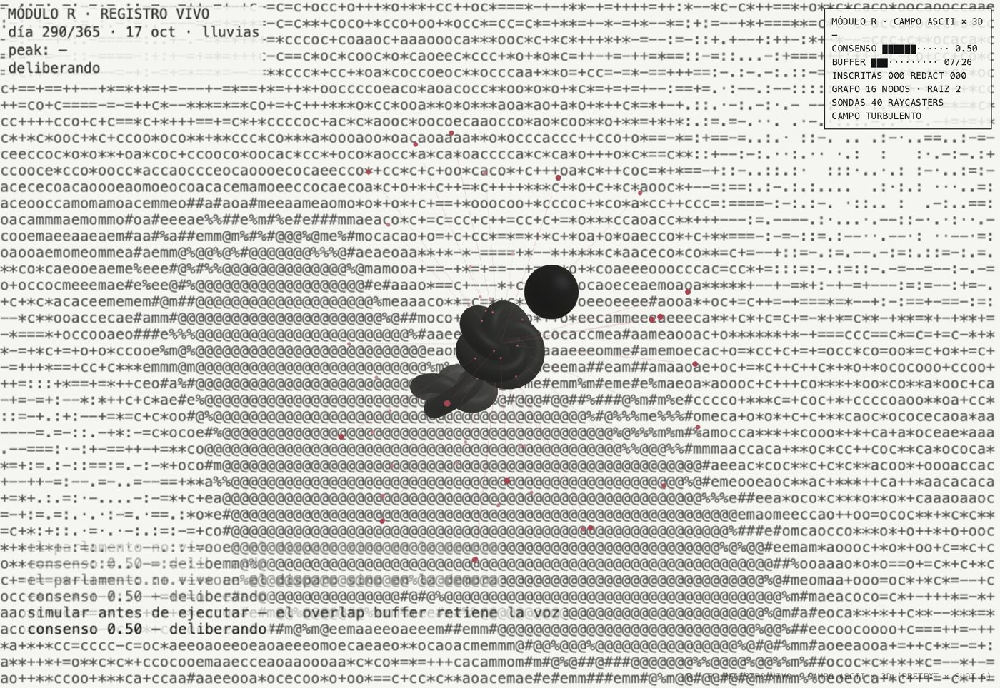
</p>

*Izquierda: módulo E · Estratos. Las señales de la cadena (/eco/\*) cambian los modos de los estratos. El consenso cambia la paleta. Un voto regenera el paisaje con una semilla nueva. Derecha: módulo R · Registro. El acta del parlamento, compuesta en vivo. Lo inscrito y la profundidad del acta vuelven al sonido.*

### Entropía de llegadas → difusión · 🔵 Cadena

El motor calcula la entropía de los intervalos entre transacciones, sobre un anillo móvil. Una cadena regular deja la grabación legible. Una cadena a ráfagas la difumina.

### Tamaño de los datos de llamada → difuminado espectral · 🔵 Cadena

Mide cuánto dice cada transacción. Una transferencia simple casi no toca el bosque. Una llamada a un contrato arrastra las magnitudes del espectro hacia los lados (`PV_MagSmear`, hasta 24 bandas).

### Congestión → saturación y filtro · 🔵 Cadena

Mide la ocupación del bloque frente a la tarifa base. La presión sobre la cadena se vuelve presión sobre la grabación.

### Valor y gas · 🔵 Cadena

El valor de una transacción va a una altura, en escala logarítmica (MIDI 36–84). El precio del gas va a una intensidad (30–120). La dirección del emisor elige el instrumento.

**Tesis**, Cap. 4 §6: la tabla de mapeo es la notación del dispositivo; cualquier lector puede leerla como partitura.

---

## 8 · Retener: la opacidad como arquitectura

`build_corpus.py` · `14_phenological_corpus.scd` · `laser-bridge.js` · blend · `build_cameratrap.py`
**Tesis:** Anexo B, Arts. 47 y 48 · Cap. 2 §4 (la opacidad como cláusula constitucional, Glissant)

Escuchar a otra especie incluye decidir qué no tomar. El código aplica la cláusula de opacidad. No solo la declara.

> **Vínculo con la tesis.** Art. 47: las especies, el bosque y la comunidad tienen derecho a no ser enteramente legibles para la Cámara, ni para ningún sistema técnico, «incluido el BiocracyEngine». La comunidad decide qué fragmentos se procesan y cuáles quedan como escucha en bruto, sin etiqueta y sin token.

<p>
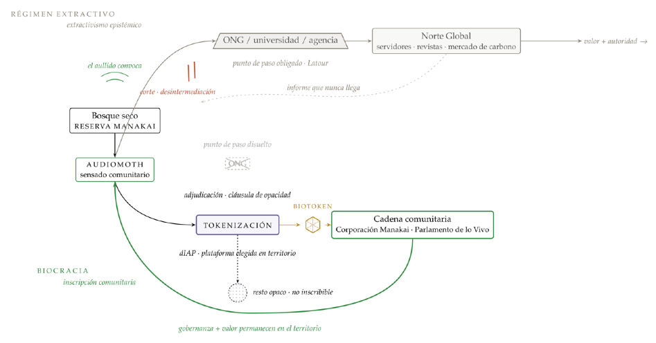
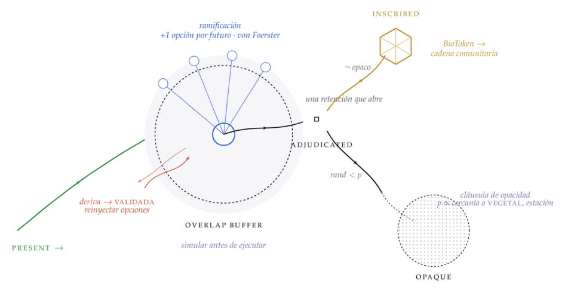
</p>

*Izquierda: tesis, Figura 4. La desintermediación. La tokenización corta la cadena del extractivismo epistémico. Una parte queda como resto opaco, no inscribible. Derecha: tesis, Anexo A, Figura 2. El Overlap Buffer. Si no es opaco, cristaliza como BioToken. Si la opacidad se activa, se retiene sin inscribirse.*

### Opacidad por hábitat · ⚪ Velo

Cada grabación recibe una sensibilidad según su hábitat CORINE: bosque denso alto 1,0; zonas pantanosas 0,9; lagunas 0,85; bosque de galería 0,8; hasta 0 en tierras degradadas. Las grabaciones con 1,0 son opacas. La tabla es una semilla: la comunidad del territorio debe editarla.

Dónde: `build_corpus.py` · `HABITAT_OPACITY`

### Piso de opacidad · ⚪ Velo

Una grabación suena solo si su opacidad es menor que 1 − piso. Por encima, no es un escaño que no se encendió: no es un escaño. Sale al mismo tiempo de la selección, del análisis, de la tokenización y de la proyección. Los llamados AVGN heredan la opacidad de su grabación. Así el proyector los retiene con el mismo piso que SuperCollider.

```
audible ⇔ opacidad < 1 − PISO OPAC
```

**Tesis**, Anexo A: `setOpacityFloor()` corresponde al Art. 47.

### Nunca se analiza, nunca se proyecta · ⚪ Velo

Las 16 grabaciones opacas no entran en AVGN y nunca se anuncian a los módulos visuales. El láser que proyecta sobre el bosque real no dibuja especies sensibles. En el módulo 9, una parte de cada huella nunca se inscribe.

### Nombres honestos en la cámara trampa · ⚪ Velo

Las 22 capturas de la Reserva Manakai guardan tres afirmaciones separadas: la etiqueta escrita en campo, el taxón más específico que esa etiqueta sostiene y el rango que realmente alcanza. Una sensibilidad fija el orden en que los registros se apagan cuando la Cámara baja el fader de opacidad.

Dónde: `tools/build_cameratrap.py`

### Lista de especies amenazadas · ⚪ Velo

Las especies amenazadas de Colombia, plantas incluidas, vienen de la API v4 de la Lista Roja de la UICN. Si la API no responde, el motor usa una lista fija. Dan la lista de especies del parlamento y el término IUCN del BioToken.

Dónde: `speciesFetcher.ts`
**Tesis**, Art. 48: la tokenización recae sobre el acto de presencia, nunca sobre la especie o el individuo como mercancía.

---

## En el domo del Planetario

El domo recibe una imagen domemaster: un círculo que cubre la cúpula completa. El motor la produce con seis cámaras en cubo alrededor de un asiento. En los módulos 0, O, T y P, el público está en el centro del dial y el dial es el cielo. En el módulo F, el público está en el suelo, sobre la red micorrícica, y mira hacia arriba a través de los estratos.

El texto de los módulos no llega al domo como HTML. Por eso el motor dibuja los nombres como planos que miran al asiento, en una capa que solo ven las cámaras del domo. Los detalles técnicos están en [Cúpula](cupula.md).

<p>
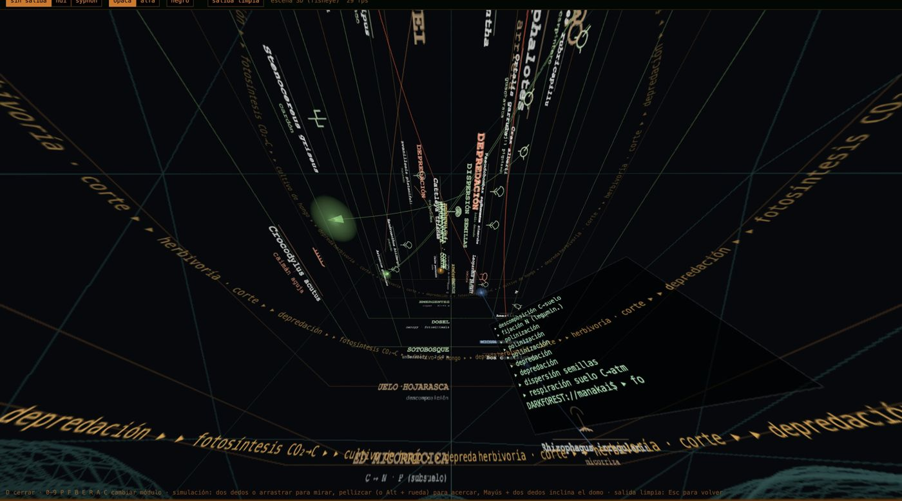
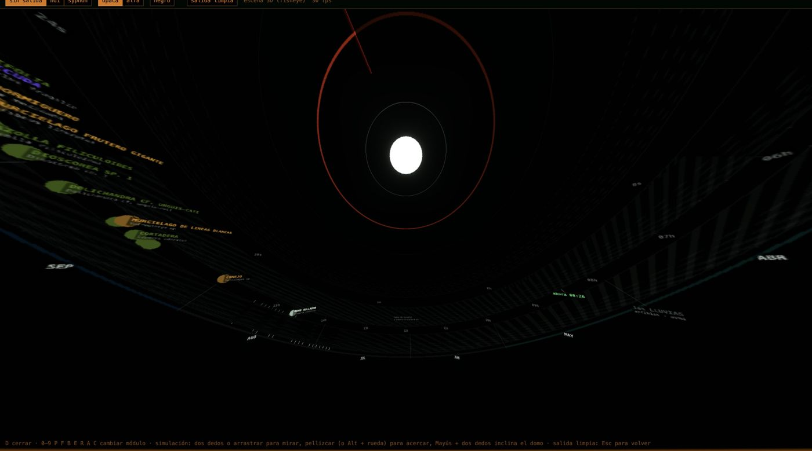
</p>

*Izquierda: el módulo F en el domo, desde el suelo hacia arriba. Los anillos de texto nombran lo que el bosque intercambia: descomposición, depredación. Derecha: el módulo 0 en el domo. El anillo del año se curva sobre el público, a unos 20° sobre el horizonte.*

---

## Lo que estos algoritmos no pueden afirmar

La tesis rechaza dos riesgos: el **ventriloquismo** (hablar por el no-humano) y la **romantización** (tratar al bosque como un sujeto con preferencias claras). Estos límites técnicos protegen contra los dos.

- **Roles, no especies.** El detector nombra funciones ecológicas: voz nocturna, coro de insectos, cambio de comunidad. No nombra taxones. Sus umbrales son supuestos de calibración. Hay que verificarlos en el sitio.
- **Estructura, no significado.** AVGN encuentra tipos de llamado por su forma. Dice qué llamados se parecen. No dice qué significa ninguno. Ninguna especie «vota» (Art. 44).
- **Una muestra nocturna de la temporada seca.** Todas las grabaciones son de 18:00 a 06:00, en 34 días de las dos temporadas secas. El corpus es sobre todo grillos y saltamontes por la hora en que grabó el AudioMoth. No representa todo el bosque seco tropical.
- **La energía de una banda no identifica.** Algunas ranas pequeñas cantan entre 4 y 6 kHz, dentro de la banda de los insectos. El primer plano conserva lo que cambia. No puede decir quién cambia.
- **La mezcla es una metáfora que se ejecuta.** Las leyes de los módulos 4 a 9 calculan números reales sobre señales reales. Pero una membrana con fuga sobre un espectro es un modelo de la escucha, no una neurona.
- **El instrumento asiste; no decide.** Si la lectura técnica y la deliberación de la comunidad no coinciden, prevalece la deliberación de la comunidad (Art. 48).

## Glosario

| Término | Definición |
|---|---|
| **AVGN** | Animal Vocalization Generative Network. Método de Sainburg, Thielk y Gentner (2020) para segmentar, proyectar y agrupar repertorios vocales. |
| **Bancada** | Grupo de escaños. En el estatuto: cinco bancadas taxonómicas. En la capa sonora: cinco grupos por rol ecológico. |
| **Coro** | Sonido continuo de muchos individuos a la vez. En este corpus, sobre todo insectos entre 4 y 8 kHz. |
| **Escaño** | El lugar de una especie o de una grabación en el anillo de 365 días. Se enciende o se apaga. |
| **Llamado** | Una vocalización corta y separada (en este corpus, de 45 a 165 ms). |
| **Opacidad** | Valor de 0 a 1 que indica cuánto se retiene una grabación. Con 1, la grabación es opaca: nunca se analiza ni se proyecta. |
| **Piso** | El nivel estable de una banda de frecuencia. El coro forma el piso. |
| **Quórum sensible** | La fracción de escaños convocados que están encendidos en un día (Art. 45). |
| **Rol ecológico** | La función de un evento sonoro en el paisaje, según el detector. No es una especie. |
| **Umbral** | El valor de presencia sobre el cual un escaño se enciende. Por defecto 0,5 (Art. 44). |

---

Documento de apoyo técnico a la tesis doctoral *[de] Bioacústica [a] Biocracia — Parlamento de lo Vivo en el Bosque Seco Tropical*. Doctorado en Diseño, Arte y Ciencia (D.A.C), Universidad Jorge Tadeo Lozano. Director: Felipe Cesar Londoño. Candidato: Alejandro Duque Jaramillo. Preparado para *Biocracia en escucha*, Notaciones y Radiofonías de CK:\WEB, Domo del Planetario de Bogotá, 21 de octubre de 2026.

Detector: [github.com/alejoduque/bioacustic-scripts](https://github.com/alejoduque/bioacustic-scripts). Corpus: AudioMoth, La Luna / Planeta Rica, Córdoba. Capturas de los módulos: 17 de octubre de 2026.

Referencias citadas: Sainburg, Thielk y Gentner (2020); McInnes, Healy y Melville (2018); Dasgupta, Stevens y Navlakha (2017); Krause (1993, 2012); Gastaldi (2021); Harris (1954); Berenguer y Gómez (2020); Pijanowski et al. (2011); Seaman y Rössler (2006); Glissant (1990).
